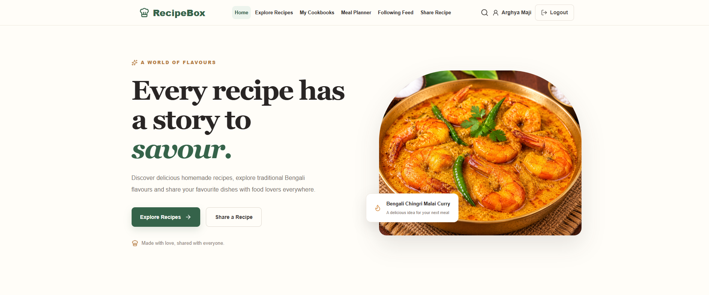
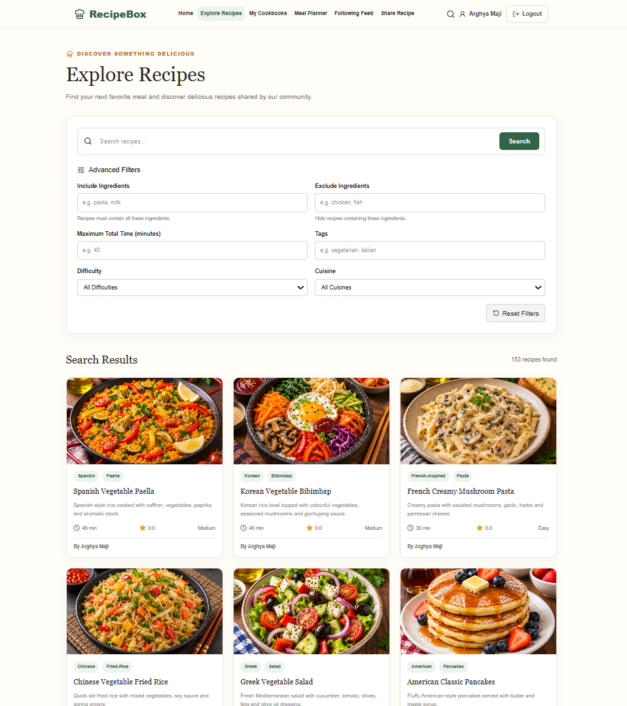
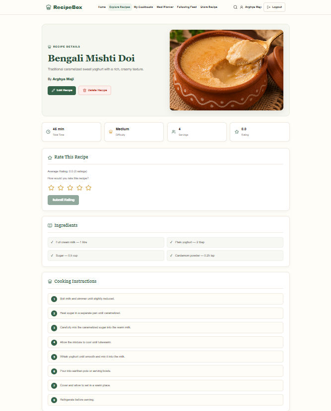
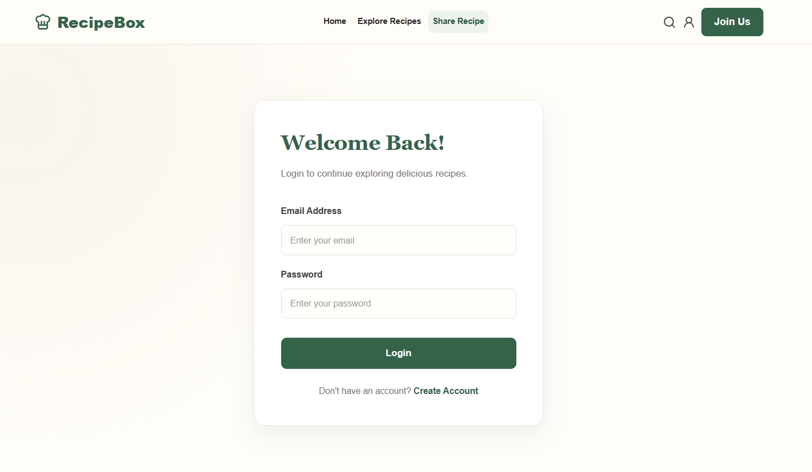
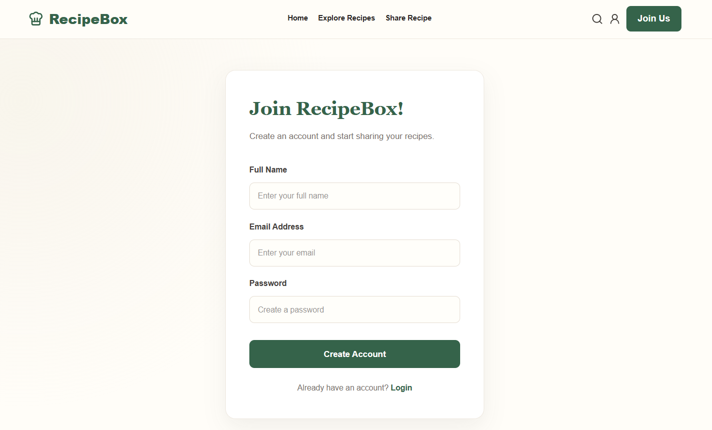
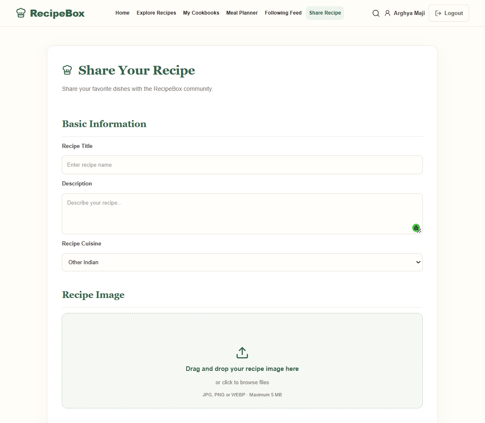
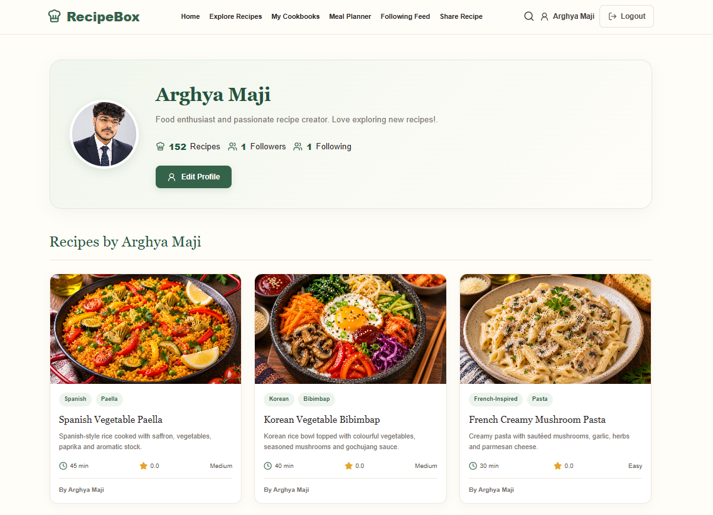
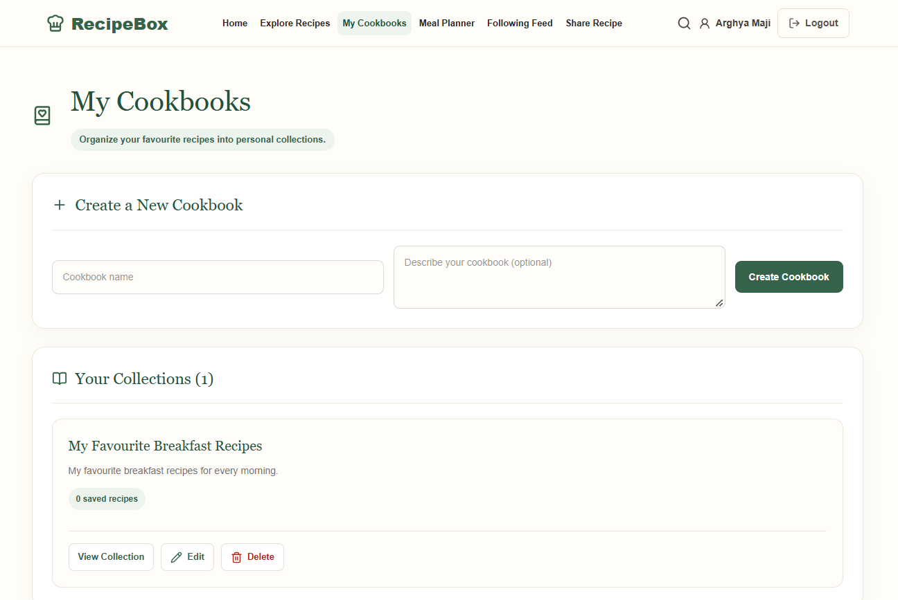
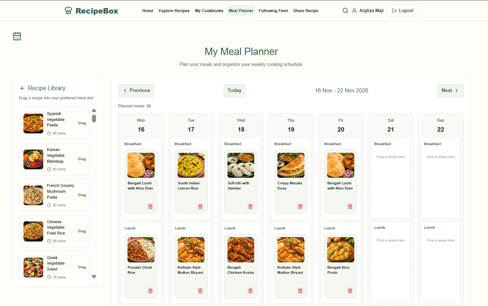

# 🍲 RecipeBox – A Collaborative Recipe Sharing Platform

**Discover recipes. Share your creations. Organize what you love.**

RecipeBox is a full-stack recipe-sharing platform that brings food lovers together. Users can explore recipes, share their own creations, follow other cooks, build personal cookbooks, and organize their weekly meals with an interactive meal planner.

Built using the MERN stack, RecipeBox combines recipe discovery, social interaction, and meal organization in one platform.

---

## 🌐 Live Demo

**RecipeBox is now live!**

- 🍲 **Live Website:** [Visit RecipeBox](https://recipebox-zeta-six.vercel.app/)
- ⚙️ **Backend API:** [RecipeBox Backend](https://recipebox-backend-mgn8.onrender.com)
- 💻 **GitHub Repository:** [View Source Code](https://github.com/Arghya-03/recipebox-recipe-sharing-platform)

Explore the platform, discover recipes, share your creations, and organize your weekly meals.

---

## ✨ Features

### 🍽️ Recipe Management
- Browse and explore community recipes.
- Create and publish your own recipes.
- Edit and delete your published recipes.
- Upload recipe images using Cloudinary.
- Add ingredients with quantities and units.
- Add step-by-step cooking instructions.
- Include preparation time, cooking time, difficulty, servings, and nutrition information.

### 🔎 Advanced Recipe Search
- Search recipes by title and description.
- Filter by ingredients to include.
- Exclude specific ingredients.
- Filter by maximum cooking time.
- Filter by cuisine, tags, and difficulty.

### 👥 Social Features
- User registration and login.
- Customizable user profiles.
- Follow and unfollow other users.
- View followers and following lists.
- Following feed to discover recipes from followed users.
- Comment on recipes.
- Rate recipes and view average ratings.

### 📚 Personal Cookbooks
- Create personal cookbooks.
- Save recipes to collections.
- View saved recipes.
- Manage your cookbook collections.

### 📅 Weekly Meal Planner
- Interactive weekly meal planner.
- Drag and drop recipes into meal slots.
- Organize meals by day and meal type.
- Navigate between weeks.
- Remove planned meals.

### 🔐 Security
- JWT-based authentication.
- Password hashing using bcrypt.
- Protected routes and API endpoints.
- Recipe ownership validation.
- Secure image upload handling.

---

## 🖥️ Screenshots

### 1. Home Page


### 2. Explore Recipes


### 3. Recipe Details


### 4. Login


### 5. Registration


### 6. Share a Recipe


### 7. User Profile


### 8. My Cookbooks


### 9. Meal Planner


---

## 🛠️ Technology Stack

| Category | Technologies |
|---|---|
| Frontend | React.js, Vite |
| Routing | React Router |
| Styling | CSS |
| Animations | Framer Motion |
| Icons | Lucide React |
| Drag and Drop | dnd-kit, React Dropzone |
| Backend | Node.js, Express.js |
| Database | MongoDB Atlas |
| ODM | Mongoose |
| Authentication | JWT, bcryptjs |
| Image Storage | Cloudinary |
| API Requests | Axios |

---

## 📁 Project Structure

```text
recipebox-recipe-sharing-platform/
│
├── client/
│   ├── public/
│   └── src/
│       ├── assets/
│       ├── components/
│       ├── context/
│       ├── pages/
│       ├── services/
│       ├── App.jsx
│       ├── App.css
│       ├── index.css
│       └── main.jsx
│
├── server/
│   ├── config/
│   ├── controllers/
│   ├── middleware/
│   ├── models/
│   ├── routes/
│   ├── seed/
│   └── index.js
│
├── Project_Screenshots/
│
└── README.md
```

---

## ⚙️ Installation and Setup

Follow these instructions to run RecipeBox locally.

### Prerequisites

Make sure you have installed:

- Node.js
- npm
- MongoDB Atlas account
- Cloudinary account
- Git

### 1. Clone the Repository

```bash
git clone https://github.com/Arghya-03/recipebox-recipe-sharing-platform.git
cd recipebox-recipe-sharing-platform
```

### 2. Set Up the Backend

```bash
cd server
npm install
```

Create a `.env` file inside the `server` directory:

```env
PORT=5000
MONGO_URI=your_mongodb_connection_string
JWT_SECRET=your_jwt_secret

CLOUDINARY_CLOUD_NAME=your_cloudinary_cloud_name
CLOUDINARY_API_KEY=your_cloudinary_api_key
CLOUDINARY_API_SECRET=your_cloudinary_api_secret
```

Replace the placeholder values with your own credentials.

Start the backend:

```bash
npm run dev
```

Backend server:

`http://localhost:5000`

### 3. Set Up the Frontend

Open a second terminal:

```bash
cd client
npm install
npm run dev
```

Open the Vite development URL:

`http://localhost:5173`

Make sure the frontend API configuration points to the correct backend URL.

---

## 🔌 API Overview

The backend API is organized into the following route groups:

| Route | Purpose |
|---|---|
| `/api/auth` | User registration, login, and authentication |
| `/api/recipes` | Recipe creation, retrieval, editing, deletion, and search |
| `/api/uploads` | Recipe and profile image uploads |
| `/api/social` | Following, user profiles, and following feed |
| `/api/comments` | Recipe comments |
| `/api/ratings` | Recipe ratings |
| `/api/cookbooks` | Personal cookbook management |
| `/api/meal-plans` | Meal planning operations |

Protected endpoints require a JWT token in the Authorization header.

---

## 🗄️ Database Models

RecipeBox uses MongoDB with Mongoose models:

- **User:** User accounts, authentication, profile details, followers, and following.
- **Recipe:** Recipe information, ingredients, instructions, cuisine, images, and ratings.
- **Comment:** Recipe comments and user references.
- **Cookbook:** Personal recipe collections.
- **MealPlan:** Planned meals and their associated dates.

---

## 🚀 Deployment

RecipeBox is successfully deployed and accessible online.

The application uses the following production deployment architecture:

| Service | Platform | Status |
|---|---|---|
| Frontend | Vercel | Deployed |
| Backend | Render | Deployed |
| Database | MongoDB Atlas | Connected |
| Image Storage | Cloudinary | Integrated |

### Live Application Links

- **Frontend:** https://recipebox-zeta-six.vercel.app/
- **Backend:** https://recipebox-backend-mgn8.onrender.com
- **Source Code:** https://github.com/Arghya-03/recipebox-recipe-sharing-platform

### Production Configuration

- Configured the production backend API URL in the frontend.
- Deployed the React application using Vercel.
- Hosted the Express.js backend using Render.
- Configured frontend routing to support direct navigation and browser page refreshes.
- Used MongoDB Atlas for cloud database hosting.
- Integrated Cloudinary for recipe and profile image storage.

The application is accessible through its live deployment URL.

---

## 👨‍💻 Author

**Arghya Maji**

- GitHub: [Arghya-03](https://github.com/Arghya-03)
- Project Repository: [RecipeBox](https://github.com/Arghya-03/recipebox-recipe-sharing-platform)
- Live Application: [RecipeBox – Live Website](https://recipebox-zeta-six.vercel.app/)

---

## 📄 License

No open-source license has been added to this repository yet.